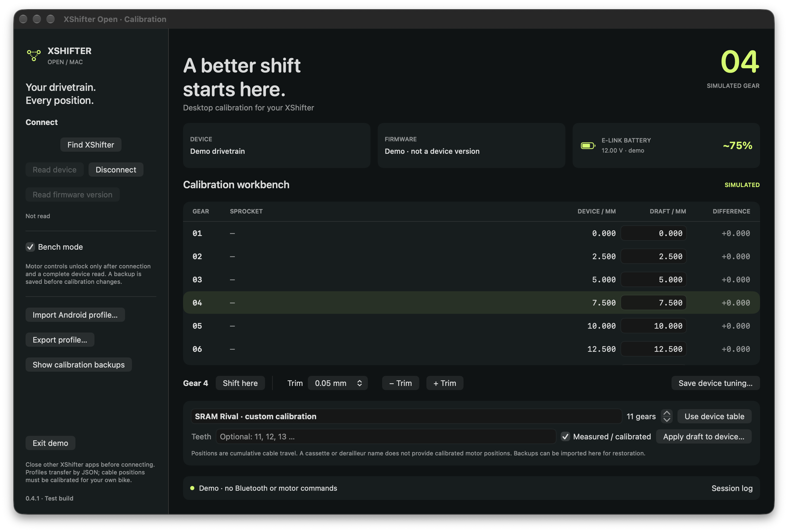
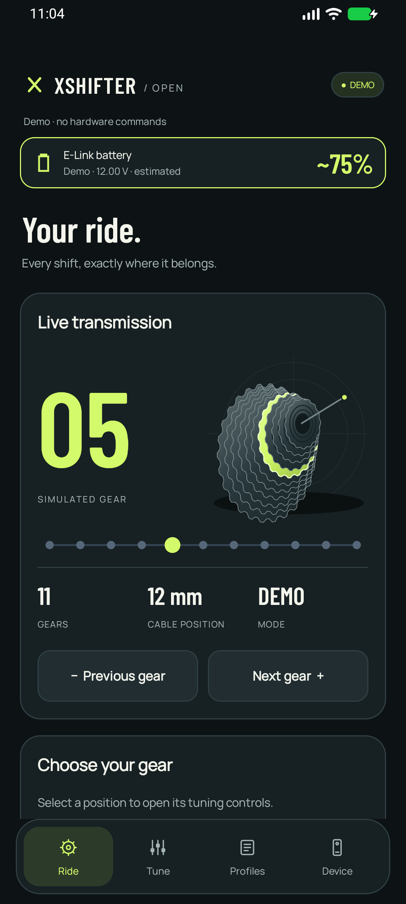
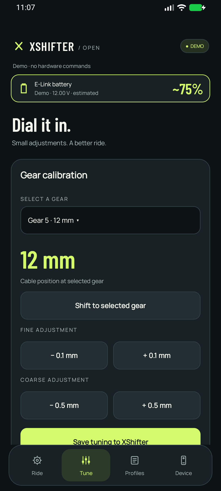
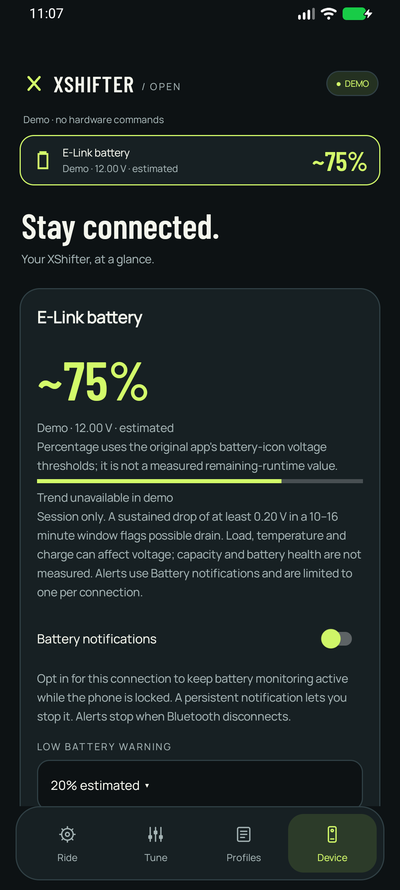

# XShifter Open

Native **Android and macOS** companion apps for XShifter E-Link: read your setup, calibrate individual gears, and carry profiles between phone and desktop.

**[Download packages](https://github.com/alexeinz/xshifter_open/releases) · [Quick-start guide](docs/QUICKSTART.md) · [Screenshots](docs/SCREENSHOTS.md)**

This is an independent, experimental project. Device commands were recovered from the original Android app; live Bluetooth, motor behaviour and power-cycle persistence still need validation on your hardware. Manufacturer names describe mechanical components, not factory-calibrated motor positions.

## Install v0.4.2

| Platform | Download | Requirements |
|---|---|---|
| Android | [Signed APK](https://github.com/alexeinz/xshifter_open/releases/download/v0.4.2/XShifter-Open-0.4.2.apk) | Android 8.0+; Bluetooth LE |
| macOS | [DMG installer](https://github.com/alexeinz/xshifter_open/releases/download/v0.4.2/XShifter-Open-0.4.2-macOS-universal.dmg) · [App ZIP](https://github.com/alexeinz/xshifter_open/releases/download/v0.4.2/XShifter-Open-0.4.2-macOS-universal.zip) | macOS 13+; Apple Silicon or Intel |

[Release notes and SHA-256 checksums](https://github.com/alexeinz/xshifter_open/releases/tag/v0.4.2). The Mac app is ad-hoc signed and **not Apple-notarized**. The Android release certificate differs from earlier local debug builds: export profiles before uninstalling the old app and installing this release. New debug builds install separately as **XShifter Open Debug**. Public release upgrades keep the same certificate and preserve app data.

## Desktop calibration



View the device table beside your draft, inspect differences in millimetres, trim the selected gear, and verify readback after applying a measured calibration. Backups are saved before changes. Demo mode works without connecting a bike.

## On your phone

<table>
<tr>
<td align="center"><br>Ride</td>
<td align="center"><br>Tune</td>
<td align="center"><br>Battery</td>
</tr>
</table>

All screenshots show **Demo mode** with simulated data.

## What is included

- Bluetooth discovery, device table readback, firmware-version and Pod information.
- Bench-gated shifting, per-gear calibration, saved tuning and calibrated-table upload.
- Android SRAM/Shimano component metadata, custom gear counts and cassette tooth lists.
- Shared JSON profile import/export and calibration backups.
- Visible battery voltage and explicitly estimated percentage on both platforms.
- Android opt-in low/critical alerts, background monitoring and session voltage-drop detection.

Firmware flashing/dumping, Pod remapping and bike-computer gear broadcasting are not implemented. Battery capacity, cycle count and health are not measured.

## Build and publish

Android: JDK 17 and Android SDK 35.

```sh
./gradlew :app:testDebugUnitTest :app:lintDebug :app:assembleDebug
```

Mac: macOS with Swift 6.2+ and the macOS SDK (Command Line Tools or Xcode).

```sh
./macos/test.sh
./macos/build.sh
./macos/package.sh
```

CI runs checks and builds on pushes, pull requests and manual dispatch. To publish a release, update `version.properties` (including a higher Android `versionCode`), commit, then push a matching `v<versionName>` tag. Releases attach the signed APK, universal Mac DMG/ZIP, quick guide, screenshots and checksums after both builds pass. Update the download table above when releasing a new version. Signing keys stay in GitHub Actions secrets; no vendor firmware or original APK is included in this repository.

Bundled fonts retain their [Barlow](app/src/main/assets/fonts/Barlow-OFL.txt) and [Manrope](app/src/main/assets/fonts/Manrope-OFL.txt) license notices.
