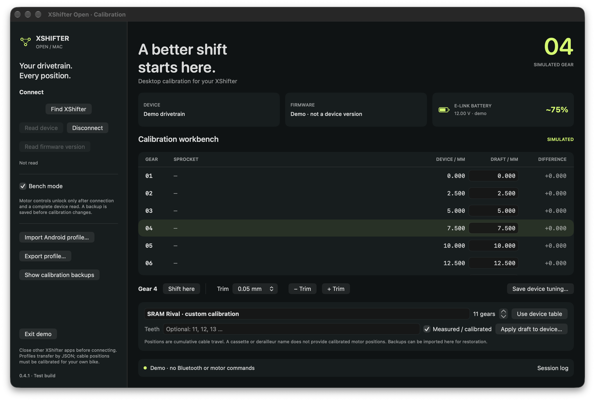
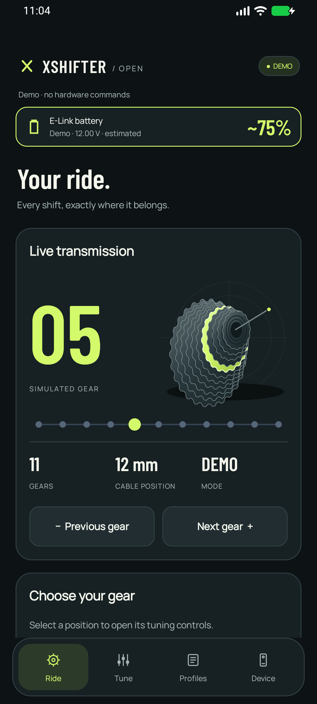
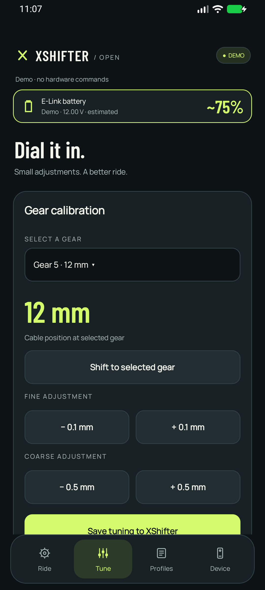
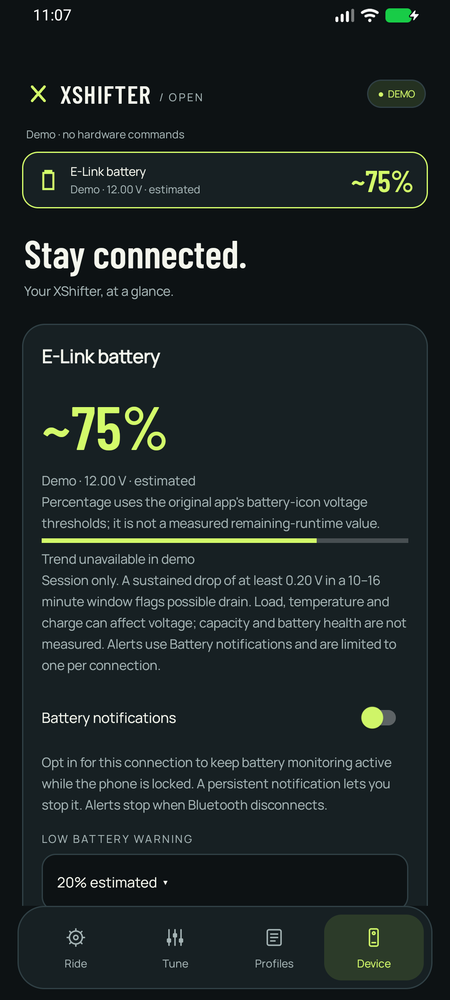

# Screenshots

Real app captures in **Demo mode**, using simulated calibration and battery readings. They do not demonstrate a verified live hardware connection.

## macOS calibration workbench

## Android Ride

## Android Tune

## Android battery

[Quick-start guide](QUICKSTART.md) · [Download packages](https://github.com/alexeinz/xshifter_open/releases)
